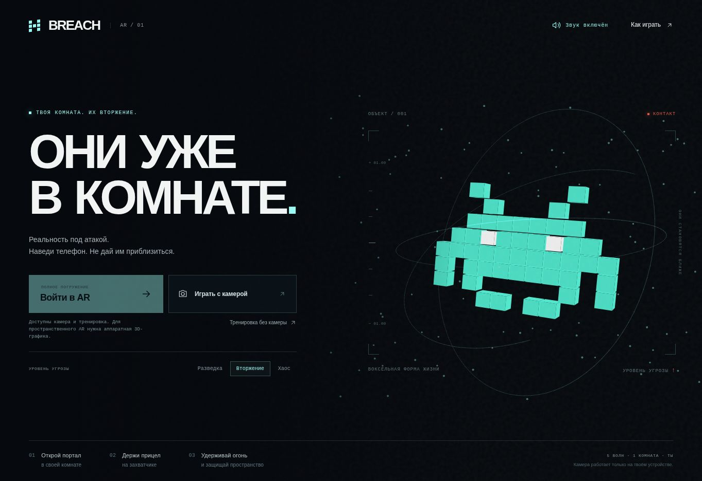

# BREACH 2 — Вторжение

Мобильная браузерная игра: объёмные воксельные захватчики появляются из порталов, приближаются к игроку и рассыпаются от лазера. Вторая версия добавляет разные роли врагов, критические выстрелы за точное наведение, выбор улучшений между волнами и финальное ядро с тремя фазами боя.

## Игровой цикл v2

**Отбей волну → выбери одно из трёх улучшений → собери бластер под свой стиль → уничтожь ядро.**

- Пять волн знакомят с угрозами постепенно: разведчики, маневрирующие фланкеры, тараны с подготовкой рывка, бронированные враги и финальный босс.
- Точное удержание прицела на ядре противника накапливает фокус. Готовый фокус превращает следующий выстрел в критический и помогает пробить защиту. Перегрев мешает поддерживать темп.
- После каждой из первых четырёх волн время останавливается. Из трёх предложений выбирается одно улучшение, действующее до конца забега. Семь направлений: охлаждение, теплоёмкость, фокус, урон, защита, импульс и скорострельность. У каждого два уровня.
- Импульс наносит урон, оглушает и уничтожает летящие заряды. Босс переживает один импульс: нужно выбирать момент применения.
- Ядро меняет поведение в трёх фазах. Его залпы можно сбить лазером; уязвимые окна показываются на отдельной шкале. Уклоняться телом не требуется.
- Серии, волны без повреждений, ранг и отдельные рекорды для каждого режима и сложности дают цель для повторных попыток. Старая версия рекорда не смешивается с новой системой очков.

HUD показывает фокус, здоровье и защиту цели, направление угроз вне поля зрения, прогресс волны и состояние босса. Звук синтезируется локально.

## Запуск

Публичная игра: https://step3dlab.github.io/Technopark_project/breach-ar/?v=2.0

1. Открыть ссылку напрямую в браузере телефона.
2. Выбрать «Войти в AR» или «Играть с камерой» и дать запрошенные разрешения.
3. По желанию установить до трёх порталов возле углов/дверных проёмов. Можно начать с автоматически выбранными точками перед игроком.
4. Наводить телефон на противника и удерживать «Огонь». Для критического выстрела держать прицел на его ядре. Отпускать кнопку для охлаждения лазера.
5. Между волнами выбирать улучшение. В финале перехватывать красные заряды и атаковать открытое ядро.

«Тренировка без камеры» доступна на компьютере и телефоне. Если WebGL отключён, включается программная 3D-графика на Canvas 2D; в ней доступны камера и тренировка, а пространственный AR отключён. Компьютер: мышь или стрелки для наведения, пробел для огня, E для импульса, P/Esc для паузы, 1/2/3 для выбора улучшения. Сенсорный экран: свайпы для наведения и кнопка огня.

## Три режима и точные ограничения

- **Пространственный AR:** `immersive-ar` WebXR, обязательный DOM overlay, система координат `local`. Положение камеры поступает из текущего `XRFrame`. Hit-test используется, если он поддержан. Без найденной поверхности портал ставится в выбранном направлении на условной дистанции 3,2 м. Подходит прежде всего для совместимых Android-устройств с Chrome и Google Play Services for AR. Возможность определяется проверкой API во время запуска; наличие кнопки не заменяет системное разрешение.
- **Камера:** локальное видео задней камеры + `deviceorientation`. Этот режим отслеживает поворот телефона, но не перемещение в комнате. При недоступном гироскопе остаётся ручное наведение свайпом. Устройство следует держать примерно в одном месте. Камера запрашивается без микрофона.
- **Тренировка:** трёхмерная арена без камеры и разрешений.

Порталы устанавливает игрок. Автоматическая реконструкция стен, окклюзия за настоящей мебелью/углами, сохранение пространственных якорей между запусками и распознавание изображения-маркера в эту версию не входят. Враги появляются у выбранных точек, а не вычисляются по неизвестной геометрии комнаты.

Игра автоматически ставится на паузу при уходе со страницы. При потере XR-позы симуляция останавливается до восстановления отслеживания. При выходе из режима камеры и при завершении миссии медиапоток останавливается. Кадры не записываются и не отправляются на сервер. Счёт и выбор звука хранятся в localStorage этого браузера.

## Устройство проекта

Статические ES-модули без сборки и сторонних CDN. Всё необходимое поставляется в этом каталоге:

- `index.html`, `styles.css` — адаптивный интерфейс и экраны состояний;
- `app.js` — камера, WebXR, гироскоп, ввод, HUD и жизненный цикл;
- `engine.js` — волны, роли врагов, босс, улучшения, фокус, попадания и эффекты;
- `audio.js` — процедурные звуки Web Audio;
- `canvas-renderer.js` — программная 3D-проекция для режима камеры и тренировки при недоступности WebGL;
- `vendor/three.module.js`, `vendor/three.core.min.js` — Three.js 0.181.2;
- `vendor/THREE-LICENSE.txt` — лицензия Three.js;
- `manifest.webmanifest`, `icon.svg` — метаданные приложения;
- `GAME_DESIGN.md` — логика игрового цикла и решений по балансу.

Локальный запуск из корня репозитория:

```sh
python3 -m http.server 8080
```

Открыть `http://localhost:8080/breach-ar/`. Для доступа с другого устройства камера и AR требуют HTTPS. На localhost доступен диагностический объект `window.__breach`; на публичном сайте он не создаётся.

## Проверка

В реальном игровом движке проверено прохождение пяти волн с четырьмя выборами улучшений, тремя фазами босса и перехватом его зарядов. При идеальном наведении на обычной сложности контрольный забег занимает около двух минут без времени чтения карточек; это технический сценарий, а не прогноз результата человека.

Пространственное отслеживание, видеокамеру и гироскоп необходимо дополнительно проверить на физическом телефоне: облачный браузер и автоматические тесты не воспроизводят реальные датчики и окружение.

## Первичные технические источники

- WebXR session и возможности: https://developer.mozilla.org/en-US/docs/Web/API/XRSystem/requestSession
- WebXR и ARCore: https://developers.google.com/ar/develop/webxr/arcore-comparison
- DOM overlays: https://immersive-web.github.io/dom-overlays/
- Hit-test: https://immersive-web.github.io/hit-test/
- Разрешение на датчики ориентации: https://developer.mozilla.org/en-US/docs/Web/API/DeviceOrientationEvent/requestPermission_static

Код и эффекты подготовлены специально для этой игры. Библиотека Three.js распространяется по лицензии MIT.

## Проверенное превью



Доступность пространственного AR определяется возможностями устройства; снимок сделан в браузере без аппаратного WebGL.
