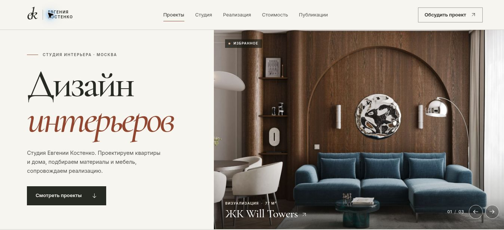

# Студия интерьера Евгении Костенко

[Открыть портфолио](https://step3dlab.github.io/Technopark_project/evgenia-kostenko/)

Статический сайт на русском языке. Главная страница объединяет 19 проектов. Каждая галерея открывается по собственной ссылке. В разделах студии собраны фотографии команды, сравнения визуализаций с реализациями, состав и стоимость услуг, примеры рабочих документов и публикации.

## Устройство сайта

- `index.html` — главная страница и каталог.
- `proekty/` — отдельная страница каждого проекта.
- `studio/`, `realizatsiya/`, `stoimost/`, `primery/`, `publikatsii/` — страницы студии и услуг.
- `assets/` — фотографии, рабочие листы, локальные шрифты, стили и интерактивные элементы.

Для локального просмотра выполните `python3 -m http.server 8000` в этой папке и откройте `http://localhost:8000/`.

## Источники

Названия, изображения, контакты и прайс взяты из [открытого портфолио студии](https://evgeniakostenko.ru/page187606109.html) и его разделов. В карточках реализованных интерьеров указаны подтверждённые публикациями авторы. Полноэкранный просмотр содержит ссылку на исходное изображение. Лицензии шрифтов Cormorant Garamond и Inter приведены в `assets/fonts/`.
