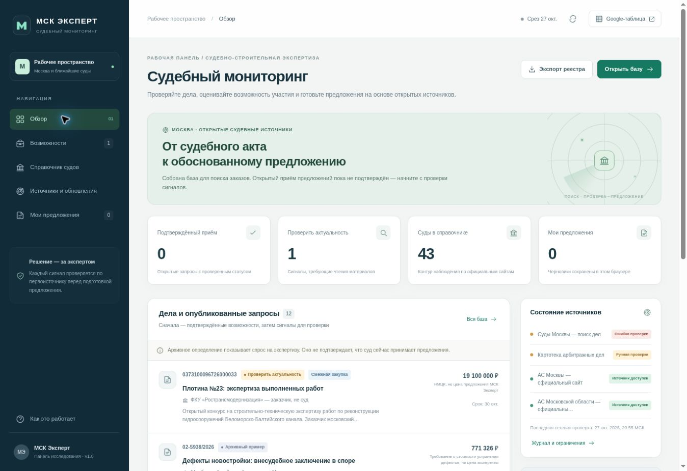

# МСК Эксперт — судебный мониторинг

Рабочая панель для поиска и проверки возможностей в судебно-строительной экспертизе. Публичные данные отделены от локальных заметок и коммерческих предложений.

[Открыть панель](https://step3dlab.github.io/Technopark_project/expert-monitor/?v=20261028.3#overview) · [Google Таблица](https://docs.google.com/spreadsheets/d/1ZyorxcS0C8UeLz2lNYO_YOHBySGTN9i1GGJ-gL6TB2E/edit)



Ежечасная исследовательская задача включена. Районные суды проверяются очередями по 7: полный проход по 35 судам — за 5 успешных запусков. Первый технический GitHub workflow завершён успешно; первый запуск новой исследовательской задачи ещё не проверен. Текущее состояние источников и время последней фактической проверки видны в панели.

## Обновление интерфейса 28 октября 2026 — v1.1

- Быстрые переходы: ближайшие 72 часа, сигналы для проверки и записи в работе.
- Фильтр по локальному рабочему статусу, срокам 72 часа / 7 дней; сортировка по сроку, публикации и проверке.
- Поиск по нескольким словам в любом порядке, включая собственные заметки; буквы е/ё эквивалентны.
- Фильтры каждого раздела сохраняются на время открытой вкладки при переходах между разделами; есть общий сброс.
- Закрытие карточки с несохранёнными заметкой, ценой или статусом требует подтверждения, включая Escape и клик снаружи. При уходе со страницы также включается защита.
- Адаптивные элементы быстрого отбора и увеличенные поля на узких экранах.

Ближайший срок не подтверждает приём: неподтверждённые сигналы сохраняют статус «Проверить актуальность». Истёкшие и архивные записи исключены из отбора ближайших сроков. Даты без времени трактуются до конца указанного дня по Москве. Данные реестра и расписания этим обновлением не изменяются.

Проверки фильтров и сроков: `node --test expert-monitor/tests/test_filters.cjs`. Выполнены 5 проверок JavaScript, 3 существующие проверки Python и валидация 43 судов / 27 записей. В браузере проверены быстрый отбор, сохранение и поиск заметки, рабочий статус, восстановление фильтров после перехода и отмена закрытия несохранённой карточки.

## Что есть в первой версии

- Справочник: все 35 районных судов Москвы и 8 основных вышестоящих / арбитражных судов.
- Исследовательские записи с номером дела или закупки, датой акта/извещения, первоисточником или честно обозначенной вторичной копией, суммой и её смыслом.
- Фильтры, поиск, детальная карточка, следующий шаг, ссылки на суд и документ.
- Редактор собственного предложения: организация, эксперт, стоимость, срок, условия; локальное сохранение, копирование и скачивание.
- Экспорт CSV/JSON и переносимая SQLite-база.
- Журнал доступности источников и кандидатов для проверки. Сайт перечитывает JSON раз в минуту.

**Срез исследования: 27 октября 2026 года.** В первоначальном наборе нет подтверждённого первоисточником открытого судебного запроса. Наличие исторического акта или слова «экспертиза» не превращает запись в доступный заказ. Полнота всего массива дел судов не гарантирована.

## Как пользоваться

1. В «Дела» выберите «Требует проверки» или найдите номер дела. Смежные закупки показаны отдельно от судебных назначений.
2. Откройте источник и последнюю карточку дела. Установите, продолжается ли выбор эксперта, не назначен ли другой исполнитель, какой срок и канал ответа.
3. Сопоставьте вопросы, квалификацию эксперта, независимость, ограничения по видам экспертиз, требуемые материалы и выезд.
4. Введите собственную стоимость и срок. Публичная сумма по делу не подставляется в ваше КП автоматически.
5. Сохраните и проверьте проект ответа. Отправьте его согласованным каналом отдельно. Эта версия ничего не рассылает.

Номера дел, суммы и ссылки — публичные данные. Рабочие цены, ФИО выбранных экспертов, заметки и КП сохраняются только в `localStorage` текущего браузера. Публичная страница не имеет кабинета и общего CRM-хранилища. Экспортируйте резервную копию перед очисткой браузера. Не используйте публичные данные GitHub для конфиденциальных приложений.

## Как устроено обновление

### Проверка публичных источников

`.github/workflows/expert-monitor.yml` запускает `scripts/monitor.py` раз в час и вручную через Actions → Run workflow. Используются только открытые страницы с проверкой robots.txt. Нет обхода CAPTCHA, авторизации или лимитов. Ответы 403, 429, ошибки и страницы с проверкой браузера сохраняются как ограничения, а не как «заказов нет».

Парсер ищет профильные ссылки и создаёт **кандидаты для проверки**. Он никогда сам не присваивает `open_confirmed`. КАД, ЕИС и JavaScript-портал открытых данных требуют отдельного исследовательского/ручного шага. Доступная главная страница не означает, что все дела суда просмотрены.

### Проверка содержания

Для регулярного исследования используется отдельная задача ChatGPT: поиск новых актов, проверка сроков, исключение уже назначенных экспертиз, обновление `data/registry.json` и исходных колонок Google Таблицы по стабильному ID. Статус настройки хранится в `meta.automation` и показывается в данных. Расписание и фактический результат задачи проверяются отдельно от технического GitHub workflow.

Google Таблица — рабочий реестр и журнал. Она не является общедоступным JSON API. Локальные заметки в панели и ввод в Google Таблице автоматически друг с другом не синхронизируются. При автоматическом обновлении таблицы **колонка «Наша цена» и лист «КП» должны сохраняться**.

GitHub может задерживать scheduled workflows. Обновление браузера каждую минуту означает проверку опубликованного JSON, а не запрос в каждый суд. На GitHub Pages данные читаются из `raw.githubusercontent.com`, поскольку push через `GITHUB_TOKEN` не запускает сборку Pages:
https://docs.github.com/en/actions/concepts/security/github_token
https://docs.github.com/en/actions/reference/workflows-and-actions/events-that-trigger-workflows

## Значения статусов

| Статус | Когда применять |
|---|---|
| `open_confirmed` | Действующий запрос найден в первоисточнике, проверена стадия, срок ещё не истёк, услуга подходит. Обязательны `openVerifiedAt` и `openEvidenceUrl`. |
| `needs_review` | Найден профильный сигнал; требуется прочитать актуальную карточку, требования и сроки. |
| `historical` | Исторический акт, ранее назначенная/выполненная экспертиза; только исследование практики и цен. |
| `closed` | Приём предложений завершён или договор уже заключён. |

`amountType=expert_fee` — стоимость экспертизы; `claim` — сумма требований; `contract` — НМЦК или цена договора (уточняется в `amountLabel`); `not_published` — не опубликована. `proposalRub` — отдельное поле собственной цены, в публичном наборе пустое. Не суммируйте эти виды сумм как потенциальную выручку.

## Данные и проверка

Основные файлы:

- `data/registry.json` — проверенный реестр с источниками и ограничениями.
- `data/monitoring.json` — журнал технической проверки и новые непроверенные ссылки.
- `data/source-config.json` — перечень источников, разрешённые автоматические проверки.
- `data/registry.sqlite`, `courts.csv`, `opportunities.csv` — переносимые выгрузки.
- `research/` — исходный исследовательский срез и методика. Не перезаписывать актуальный реестр старым срезом при очередном мониторинге.
- `scripts/validate.py` — контроль статусов, цен, ссылок и дат.
- `scripts/database.py` — пересборка SQLite и CSV из текущего реестра.

Локальный запуск опубликованной папки:

```bash
python -m http.server 8080 --directory expert-monitor
```

Проверки:

```bash
python -m unittest discover -s expert-monitor/tests -v
python expert-monitor/scripts/validate.py --data-dir expert-monitor/data
python expert-monitor/scripts/database.py --data-dir expert-monitor/data
python expert-monitor/scripts/monitor.py --data-dir expert-monitor/data
```

`--offline` у monitor.py создаёт честный журнал «не проверено» и предназначен только для среды без сети. Не выдавайте его за успешный запуск мониторинга.

## Процессуальная основа

Судебное назначение экспертизы не следует смешивать с обычной закупкой. Порядок выбора конкретного эксперта, сведений о квалификации, цене и сроке описан в пунктах 1–2, 4, 7 и 22 Постановления Пленума ВАС РФ от 04.04.2014 №23:
https://arbitr.ru/materials/107383?path=/arxiv/post_plenum/

Служебный email суда не обязательно является каналом подачи процессуальных документов. Например, Бабушкинский суд прямо указывает исходящее назначение опубликованной почты:
https://mos-gorsud.ru/rs/babushkinskij/help/hours

Перед предложением кандидатуры проверьте применимость ограничений по видам экспертиз (распоряжение №3214-р с изменениями), в том числе по делам о самовольном строительстве. Никакие заявления об «аккредитации при всех судах» или гарантии назначения в системе не используются.

## Следующий этап

Для совместной CRM с общими заметками и автоматической отправкой потребуются закрытое серверное хранилище, роли пользователей, учётный канал отправки, подтверждённые реквизиты и эксперты, согласованный шаблон и журнал подтверждения подачи. Не храните почтовые пароли и токены в публичном репозитории или коде браузера.
