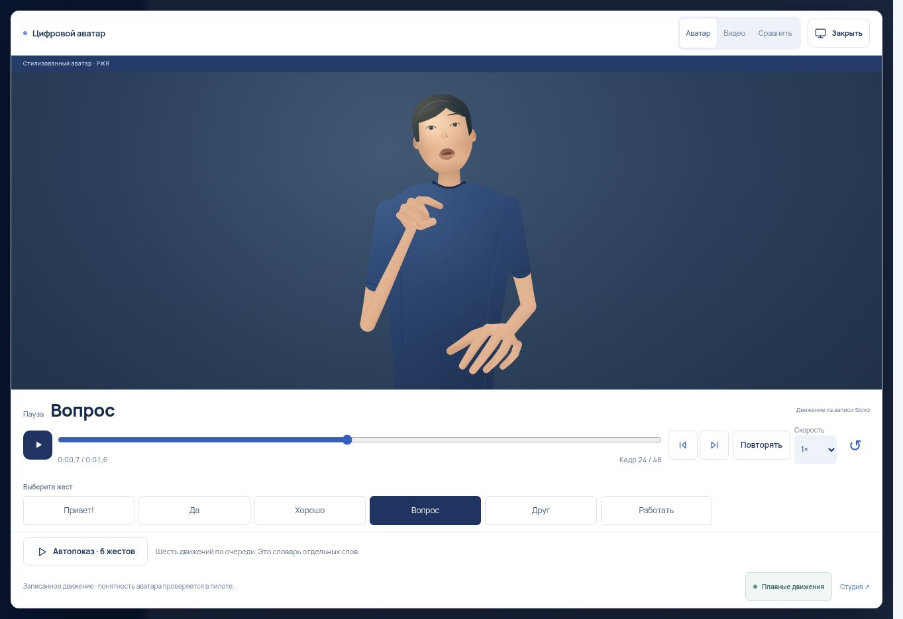
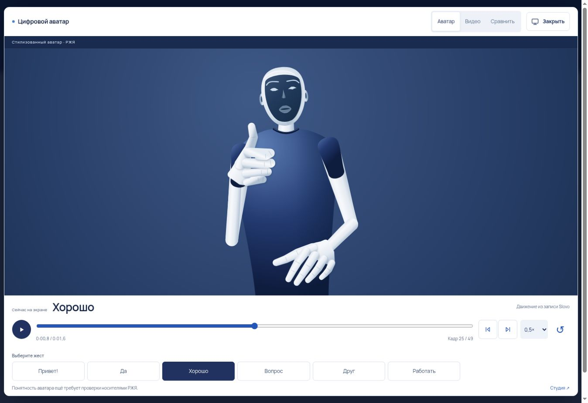
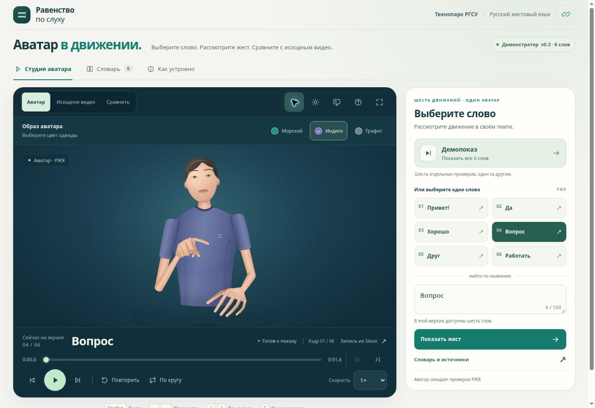

# Равенство по слуху — помощник для общения

## Версия 0.15 — 3D-собеседник и практическое общение

[Открыть 3D-собеседника](https://step3dlab.github.io/Technopark_project/hearing-equality/app/#text) · [Общение](https://step3dlab.github.io/Technopark_project/hearing-equality/app/#dialogue) · [Описание и проверка](docs/AVATAR_3D_V015.md) · [Скачать GLB](app/assets/models/rgsu-human-rig.glb).

Объёмная модель человека с 62 костями, суставами всех пальцев и деформируемой сеткой. Доступны поворот, приближение, полный рост и просмотр скелета. Записанные движения переносятся на модель; исходное видео доступно рядом. Three.js включён локально. При отсутствии WebGL тот же 3D-персонаж рисуется программным растеризатором.

Для повседневного общения: 29 текстовых фраз в пяти ситуациях, показ сообщения крупно с полем ответа собеседника, копирование/передача/скачивание текста, перенос личных образцов жестов между устройствами. Сохранены крупный текст, контраст, добровольное сохранение черновика и пометки демопримеров из параллельного выпуска 0.13. История разговора по-прежнему хранится только в текущей вкладке.

**Границы:** показ и экспериментальное распознавание ограничены шестью словами РЖЯ. Это не свободный переводчик и не языковая модель собеседника. Глубина движения оценена по одной камере; понятность новой 3D-анимации ещё нужно проверить с носителями РЖЯ. Алгоритм распознавания и его контрольный результат не изменялись.

Проверено: **190 автоматических тестов**, происхождение всех шести записей, управление 3D и двусторонний текстовый разговор в браузере. Комплект «Подготовить показ» содержит **52 ресурса**; модель GLB для скачивания и внешние средства камеры/голосового ввода не входят в него. Подробные ограничения проверки указаны в описании выпуска.

## История выпусков

### Версия 0.13 — составить, показать и передать сообщение

[Открыть «Общение»](https://step3dlab.github.io/Technopark_project/hearing-equality/app/#dialogue) · [Позиционирование и описание выпуска](docs/COMMUNICATION_V013.md) · [Аватар](https://step3dlab.github.io/Technopark_project/hearing-equality/app/#text).

Главный экран помогает выразить и передать мысль: один редактируемый черновик до 2000 знаков, текстовые заготовки, крупный показ, озвучивание, копирование, системное меню «Поделиться» и сохранение `.txt`. Собеседник может написать или продиктовать ответ; подтверждённые реплики можно сохранить вместе.

Камера предлагает отдельное слово из экспериментального словаря РЖЯ. Пользователь проверяет вариант и сам добавляет его в сообщение. Переключение разделов, ошибка распознавания или отмена передачи не стирают общий черновик. Ручной редактор доступен независимо от загрузки каталога и модели камеры.

**Распознавание не расширено до свободной речи:** текущий словарь содержит шесть слов. Практическая польза редактора и передачи текста отделена от исследования распознавания и понятности аватара. Черновик и история не отправляются на сервер приложения и не сохраняются между перезагрузками — нужный текст можно скопировать или скачать.

[Показ за 3 минуты 40 секунд](docs/DEMO_V013.md). Перед выступлением откройте **«Инструменты» → «Подготовить показ»** и дождитесь готовности всех **38 ресурсов**.

## Версия 0.12 — устойчивое движение и удобный крупный просмотр

Доработаны лицо, материалы одежды и соединение пальцев с ладонью. Исправлено сглаживание, которое могло передавать шум плеч спокойной голове. В основном приложении доступны повтор текущего жеста с неподвижной паузой, скорость 0,25× и автопоказ внутри крупного окна. На телефоне сцена больше не сжимается из-за панели управления.

[Открыть приложение](https://step3dlab.github.io/Technopark_project/hearing-equality/app/#text) · [Что изменено и проверено](docs/AVATAR_V012.md) · [Видео шести жестов](docs/avatar-demo-v012.mp4).

Геометрическая метрика дрожания головы снижена на 26,2% относительно 0.11. Исходные координаты, мимические конфигурации и распознаватель сохранены. Это техническое улучшение представления движения; понятность РЖЯ проверяется отдельно.

Для выступления: нажмите «Подготовить показ» и дождитесь сохранения всех 36 ресурсов. Клавиша **F** откроет крупный просмотр; **«Автопоказ · 6 жестов»** последовательно покажет словарь. Для разбора выбранного слова доступны **0,25×**, покадровые стрелки и **«Сравнить»** с исходной записью.



## Версия 0.11 — новый аватар и плавные движения

Стилизованный персонаж с естественным тоном кожи, цельной одеждой, читаемыми кистями и более устойчивым кадрированием. Адаптивное сглаживание мелкого дрожания включено по умолчанию; кнопка «Плавные движения» позволяет сравнить его с исходными координатами без сброса воспроизведения. Быстрые движения, конфигурации пальцев и исходные данные сохранены.

[Открыть приложение](https://step3dlab.github.io/Technopark_project/hearing-equality/app/#text) · [Видео шести жестов](docs/avatar-demo-v011.mp4) · [Что изменено и как проверено](docs/AVATAR_V011.md).

Проверено 111 программных сценариев. На спокойных участках записей геометрическая метрика дрожания запястий снижена на 70,9%; это не оценка понятности жестового языка. Полный разбор метода, границ и результатов приведён в заметке о версии.


## Версия 0.10 — демонстрация 30 октября 2026

Открыть приложение: https://step3dlab.github.io/Technopark_project/hearing-equality/app/#text

Доработана рабочая область в цветах РГСУ, смягчён стиль аватара, добавлены автопоказ шести слов, памятка выступающему и явная подготовка материалов для автономной демонстрации. Сохранённый набор охватывает основной интерфейс, движения, исходные видео и готовые координаты; внешняя модель камеры, голосовые службы и отдельная студия в него не входят.

Улучшена обработка зависаний модели и загрузки данных, остановка камеры и голосового ввода. Исходные движения и пороги сравнения сохранены. Контрольный результат остаётся прежним: **4 верных ответа, 8 отказов, 0 ошибочных принятых ответов на 12 отдельных видео**. Живая камера и понятность аватара требуют пользовательского исследования.

- [Памятка для показа: пять минут](docs/NTS_DEMO_SCRIPT_V010.md)
- [Что делает Google: SL2T, SignGemma и MediaPipe](docs/GOOGLE_SIGN_REVIEW_2026-10.md)

**Версия 0.9, 28.10.2026.** Исследовательский веб-прототип для показа на НТС: жесты, текст, голос, видео и цифровой аватар.

[Открыть приложение](https://step3dlab.github.io/Technopark_project/hearing-equality/app/) · [Студия аватара](https://step3dlab.github.io/Technopark_project/hearing-equality/app/studio.html) · [Аватар v0.9](docs/RELEASE_V09.md) · [Брифинг пяти ИИ-ролей](docs/AVATAR_BRIEF_V09.md) · [Дизайн v0.8](docs/RELEASE_V08.md) · [Изменения v0.7](docs/RELEASE_V07.md) · [Проверка](docs/EVALUATION_V07.md) · [Анимация v0.6](docs/RELEASE_V06.md) · [Диалог v0.5](docs/RELEASE_V05.md) · [Показ на НТС за 3 минуты](docs/NTS_DEMO_SCRIPT.md)

| Режим | Что реализовано |
|---|---|
| Диалог | Два собеседника, проверка слова перед озвучиванием, общая история |
| Испытание | Отдельные видеозаписи, серия из 12 заданий с камеры, исправления отдельно от совпадений, отчёт JSON |
| Текст / голос → жесты | Выбор одного из шести записанных слов, аватар и синхронное сравнение с оригиналом |
| Камера → текст / голос | Экспериментальное сопоставление движения с шаблонами; запись собственных образцов |
| Видео → текст / голос | Загрузка короткого ролика, извлечение координат, сравнение с ограниченным словарём |
| Разбор исходной записи | Явно подписанное воспроизведение готовых координат; работает без запуска модели |
| Показ для НТС | Шесть экранов: задача, сценарий, возможности, проверка, Google и пилот |

**Это не универсальный переводчик РЖЯ.** Доступны шесть слов: Привет!, Да, Хорошо, Вопрос, Друг, Работать. Понятность аватара не проверена носителями РЖЯ; проведена небольшая офлайн-проверка на 12 записях других исполнителей: 4 верных ответа, 8 отказов, 0 ошибочных ответов. Это не оценка точности на произвольных пользователях. DTW-расстояние не является вероятностью. Для неизвестных и неоднозначных движений предусмотрен отказ. Последовательность отдельных слов не объявляется переводом предложения.

Камера и обработка нового видео требуют HTTPS, WebGL и первоначальной загрузки MediaPipe с jsDelivr. Модельная цепочка на физическом телефоне требует отдельной репетиции: в среде браузерной проверки WebGL недоступен. Голосовой ввод и озвучивание зависят от браузера/ОС. Аудио при голосовом вводе может уходить службе браузера; видео пользователя приложение на сервер не отправляет.

В версии 0.7 заменены три исходные записи аватара: «Привет!», «Хорошо», «Друг». У первых двух кисти отслежены во всех кадрах; у «Друг» два внутренних пропуска заполнены только при показе. Библиотека распознавания — 21 образец от трёх исполнителей. [План записи 20 сообщений](docs/PILOT_RECORDING_BRIEF.md).

В версии 0.8 интерфейс оформлен в синем и белом цветах РГСУ. Аватар получил явно цифровой образ: светлые объёмные руки, тёмно-синий корпус и условное лицо с мимикой из исходных координат. Это стилизация, а не фотореалистичная модель человека.

В версии 0.9 устранена нестабильная геометрия сильно согнутых пальцев, сглажены оболочки локтей и возвращены измеренные контуры век и рта. В основном приложении доступны крупный просмотр, исходное видео во всю сцену и переход по записанным кадрам. [Результаты брифинга](docs/AVATAR_BRIEF_V09.md) содержат решения и ограничения.



Отдельная студия использует тот же обновлённый аватар. Ниже сохранено описание её исходной версии.

---

# Равенство по слуху — технический демонстратор

Текст → выбор записи из небольшого словаря РЖЯ → движение стилизованного аватара.

**Версия 0.3, 27.10.2026.** Студия для показа и изучения шести примеров русского жестового языка. Это исследовательский демонстратор: понятность анимаций носителями РЖЯ ещё не проверена, полноценный перевод произвольных предложений не реализован.

## Открыть

[Открыть студию аватара](https://step3dlab.github.io/Technopark_project/hearing-equality/app/?word=question)

В публичной версии `index.html` открывает приложение из `app/`. Всё выполняется в браузере. Ввод пользователя не отправляется в API; телеметрия и платные внешние сервисы отсутствуют. При первом открытии нужен доступ к файлам сайта. Полная работа без сети через service worker в этой версии не реализована.

## Что уже работает

- Шесть слов: **Привет!, Да, Хорошо, Вопрос, Друг, Работать**.
- Ввод слова и быстрый выбор примера; неизвестные предложения и отрицания не сокращаются до знакомых слов.
- Стилизованный аватар Canvas 2D с движениями тела, кистей и элементами лица, извлечёнными из реальных видеоклипов Slovo.
- Три режима: аватар, исходная запись, синхронное сравнение рядом.
- **Демопоказ всех шести примеров** с отдельной паузой между словами и остановкой после последнего.
- Пауза, повтор, перемотка и шаг по кадрам; скорости 0,5× / 0,75× / 1×, повтор одного слова по кругу.
- Режим показа для совещаний, полноэкранный просмотр, светлая и тёмная сцены; три цвета одежды аватара.
- Предыдущее/следующее слово, поиск по каталогу, справка по управлению и ссылка с выбранным словом и настройками просмотра.
- Источники, оригинальные аннотации, контрольные суммы и лицензия данных.

Здесь нет обученной нами модели text-to-sign. Текст выбирает заранее подготовленную запись. Аватар нарисован кодом; собственное узнаваемое лицо человека не клонируется. Часть координат кистей в исходных кадрах не распознана: такие пальцы не синтезируются и могут временно отсутствовать. Точные пропуски приведены в [происхождении данных](docs/ASSET_PROVENANCE.md).

## Студия аватара: обновление 0.3



Аватар занимает основную область экрана; слово и управление вынесены под сцену. Доработаны лицо, светотень, одежда и кисти. Можно выбрать бирюзовый, индиго или графитовый цвет одежды и светлый либо тёмный фон. Внешность стилизована, суставные точки и траектории сохраняются. Первый экран по умолчанию открывает «Вопрос»: в этой исходной записи обе кисти отслежены во всех кадрах.

**Демопоказ** последовательно воспроизводит шесть отдельных записей. Между примерами выдерживается пауза 0,9 секунды; после последнего показ завершается. Его можно приостановить и продолжить. При уходе со вкладки приложения или скрытии страницы воспроизведение останавливается с сохранением позиции. Ручной выбор другого слова, отправка текста или включение повтора одного слова завершают демопоказ. Последовательность примеров не является переводом предложения.

На мобильном экране сцена идёт первой, а выбор слова возвращает к её просмотру. Фон, скорость и цвет одежды сохраняются в этом браузере. Скопированная ссылка сохраняет слово, режим просмотра, скорость, фон и цвет одежды; открытие ссылки не запускает движение.

Начальная загрузка всегда показывает неподвижный кадр. Системное предпочтение уменьшения анимации отключает автоматический старт при обычном выборе слова. Явное нажатие воспроизведения или запуска демопоказа разрешает движение.

### Управление

| Клавиши | Действие |
|---|---|
| Пробел | Воспроизведение / пауза |
| R | Повторить выбранное слово |
| L | Включить / выключить повтор одного слова по кругу |
| F | Открыть / закрыть режим показа |
| Esc | Закрыть открытый диалог или выйти из режима показа |
| ← / → | Перемотать на 0,1 секунды; с Shift — на 0,5 секунды |
| [ / ] | Остановиться и перейти на предыдущий / следующий кадр |

Шкала показывает время с десятыми долями секунды и положение в кадрах. Справка доступна в интерфейсе. При вводе текста и использовании стандартных элементов управления сохраняется их обычное поведение.

В режиме аватара время учитывает фактический интервал между кадрами отрисовки: редкие обновления экрана больше не растягивают движение при той же выбранной скорости. Скрытие страницы по-прежнему ставит показ на паузу.

Подробности — в [описании выпуска 0.3](docs/RELEASE_V03.md).

## Как показать на встрече за 2 минуты

1. Откройте студию. При необходимости выберите фон и цвет одежды под экран или проектор.
2. Нажмите **«Демопоказ»**. Приложение покажет все шесть отдельных примеров; **F** включит крупную сцену для аудитории.
3. Приостановите показ, включите **0,5×** и нажмите **«Сравнить»**: аватар и исходная запись используют общее время воспроизведения.
4. Выберите **«Вопрос»** и рассмотрите движение по кадрам. В этом образце обе кисти отслежены во всех кадрах; это наблюдение о данных, а не оценка понятности жеста.
5. Выйдите из режима показа и введите **«не работать»**: интерфейс сообщит, что соответствующей записи нет.
6. Откройте **«Как устроено»** и объясните следующий этап — подготовку целых сообщений с переводчиком и носителями РЖЯ. Скопируйте ссылку, чтобы передать выбранный пример и настройки просмотра.

Корректное описание показа: «Мы проверяем техническую цепочку выбора жеста по тексту и переноса измеренных движений на аватар. Следующая задача — получить и проверить целые сообщения для конкретных сценариев».

## Локальный запуск

Из этой папки:

```bash
python -m http.server 8000
```

Откройте `http://localhost:8000/app/`. Прямое открытие `index.html` через `file://` не подходит для загрузки JSON. Установка JavaScript-зависимостей не требуется.

Проверки:

```bash
node tests/catalog.test.mjs
node tests/studio-settings.test.mjs
node tests/playback.test.mjs
node scripts/verify.mjs
```

`verify.mjs` дополнительно запускает обычные assert-проверки вне тестового раннера: все записи, хеши, происхождение движения и важные случаи отрицаний/вопросов.

`playback.test.mjs` выполняет настоящий контроллер приложения в управляемом окружении: проверяет последовательность слов, паузу между примерами, отмену переходов, смену режима, уменьшение анимации, скрытие во время загрузки и задержку кадра отрисовки. Это проверка логики контроллера, а не замена проверке интерфейса и медиаплеера в браузере.

## Повторное извлечение движений

Python 3.12 и отдельное окружение:

```bash
python -m venv .venv
# Linux / macOS:
.venv/bin/pip install mediapipe==0.10.21
.venv/bin/python scripts/extract_motion.py app/assets/sources/*.mp4
```

Для Windows используйте `.venv\Scripts\python.exe` и перечислите пути MP4, если оболочка не раскрывает `*.mp4`. Исходные видео уже входят в поставку. Скрипт сохраняет координаты, частоту кадров, число кадров, метод извлечения и SHA-256 видео. Модель извлечения движений не запускается у посетителя сайта.

## Дальнейший MVP

Рекомендация — 20 полных сообщений для встречи и сопровождения посетителей. Каждое сообщение должно получить перевод РЖЯ, запись, анимацию и проверку понимания. Для подготовки полноценного 3D-персонажа изучена связка **Animics → собственная модель → Performs**.

- [Обзор технологий, ограничения и план](docs/TECHNOLOGY_REVIEW.md)
- [Объём следующего MVP и протокол проверки](docs/MVP_PLAN.md)
- [Происхождение данных и пропуски отслеживания](docs/ASSET_PROVENANCE.md)
- [Лицензии и атрибуция](THIRD_PARTY.md)

## Лицензии

Код приложения и документация — MIT, см. [LICENSE](LICENSE).

**Видеозаписи, исходная разметка и производные координаты Slovo исключены из MIT.** Для них сохраняется специальная публичная лицензия Slovo — [полный текст](app/assets/sources/SLOVO-LICENSE-en.pdf), внутреннее обозначение `LicenseRef-Slovo-Public-License`. Это не стандартная лицензия Creative Commons. Материалы предоставляются как есть, без гарантии пригодности для конкретного применения.

Slovo: Alexander Kapitanov, Karina Kvanchiani, Alexander Nagaev, Elizaveta Petrova. [Официальный репозиторий](https://github.com/ai-forever/slovo), [статья](https://arxiv.org/abs/2305.14527). Авторы Slovo не заявлены партнёрами или проверяющими этого демонстратора.
