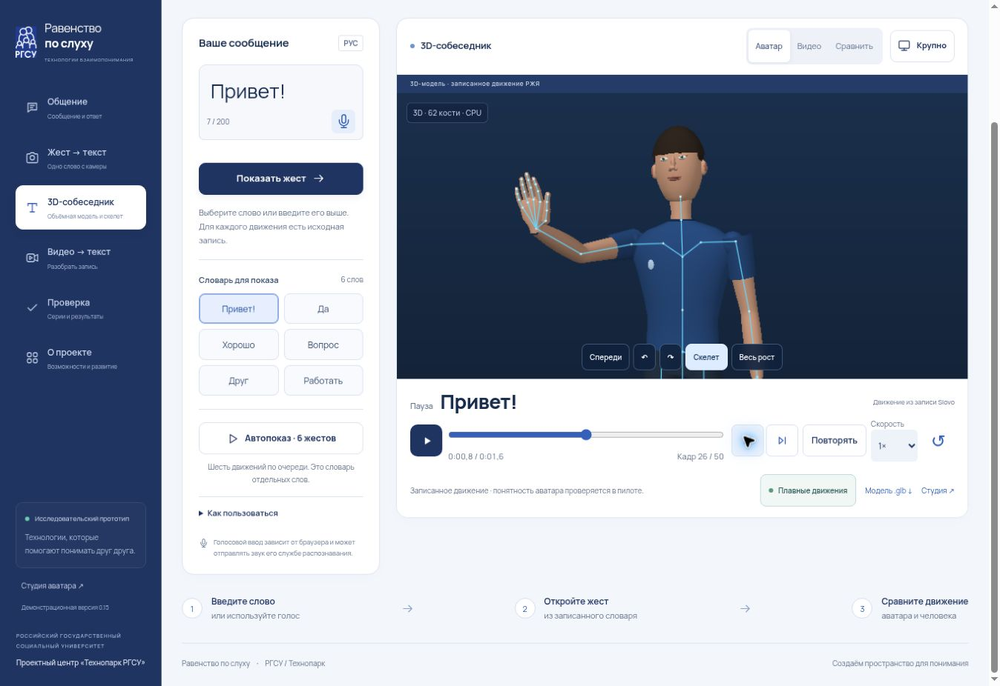

# 3D-собеседник и общение: версия 0.15

Дата: 29 октября 2026 года.

## Основа и объединение

Найдены опубликованная версия 0.12, сохранённая сборка 0.13 и появившийся во время работы коммит `00e6baeb9057baa8e81fc0b89ba0b7dc04269e51` с альтернативной доработкой общения. В новый выпуск перенесены функции общения и модель хранения черновика из последнего коммита; его аудит и результаты проверок сохранены как исторические документы. Все изменения находятся в `hearing-equality`; соседние проекты не изменяются.

## Настоящая 3D-модель

- Собственная геометрия человека: 62 кости, 120 объектов SkinnedMesh. Тело, голова, кисти, по три управляемые фаланги каждого пальца, ноги и обувь.
- Все поверхности имеют skinIndex/skinWeight. Кости деформируют вершины; камера действительно меняет перспективу. Готовые 2D-спрайты не используются.
- Three.js 0.180.0, материалы, направленное и заполняющее освещение, тени при WebGL. OrbitControls: мышь/касание, колесо, клавиши влево/вправо и Home; отдельные доступные кнопки поворота, сброса, скелета и полного роста.
- Записанные координаты Slovo переносятся на скелет. Двухзвенная обратная кинематика ограничивает достижимость и сохраняет длину конечностей. Пальцы следуют точкам кисти. При пропуске кисти её поверхность скрывается.
- При отсутствии WebGL используется CPU-растеризатор той же сетки, костей и перспективной камеры, с буфером глубины и освещением. Его разрешение и скорость ниже; динамических теней нет.
- `app/assets/models/rgsu-human-rig.glb`: экспорт исходной позы для Blender/Unity. Анимационные клипы в этот GLB не встроены: перенос движения происходит в приложении. Пересоздание: `node scripts/export-3d.mjs`.

Это стилизованная модель, а не фотограмметрический цифровой двойник. Монокулярные точки не дают достоверной глубины: положение кисти перед лицом и торсом оценочное. Мимика и лингвистически значимые немануальные компоненты не воспроизведены полностью. Просмотр со стороны полезен для технической проверки, но не является восстановлением истинного 3D-захвата. Исходное видео остаётся доступным для сравнения.

## Практическая польза

29 текстовых заготовок: повседневное общение, учёба, магазин, транспорт и приём. Поиск работает по всем ситуациям. Полноэкранный разговор включает ответ собеседника, короткие варианты и поворот читаемого сообщения. Быстрый вариант заполняет поле, но не отправляет его без нажатия.

Редактор сохраняет текст при переходах. Крупный текст и контраст доступны отдельно. Сохранение черновика на устройстве выключено по умолчанию; включается явно. Совместим с ключом предыдущего выпуска. История не сохраняется между перезагрузками. Демопримеры помечаются в редакторе, истории и экспорте. Подтверждённая попытка не вставляется дважды.

Личные образцы можно экспортировать в JSON, просмотреть и импортировать на другом устройстве: только подписи и координаты, без видео и истории. Вход проверяется по структуре, качеству, числу кадров и размеру. Максимум 12 образцов, файл до 2 МБ. Это персональные сочетания движения и подписи, не проверенный словарь РЖЯ.

3D-собеседник воспроизводит ответ, совпадающий с одним из шести записанных слов. Произвольный текст не преобразуется в выдуманные жесты. Никакого скрытого LLM-чата или универсального перевода нет.

## Проверка

- `npm test`: 190/190. В том числе веса и иерархия костей; фактическая деформация вершин; все записанные кадры сохраняют длины костей, конечные преобразования и исходные данные; восстановление пропущенных кистей только по существующим точкам; профиль образцов; передача, ограничения и происхождение текста.
- `npm run verify`: 6 записей, SHA-256 видео, происхождение движений и 9 неподдерживаемых/меняющих смысл вводов.
- Браузер: поворот, скелет, полный рост, проигрывание жеста; фраза → крупный показ → ответ «Да» → обе реплики в истории; ответ «Хорошо» → 3D-жест.
- Адаптивная сцена проверена во фреймах шириной 320 и 390 пикселей: горизонтального переполнения нет (clientWidth/scrollWidth 305/305 и 375/375 с учётом полосы прокрутки). Это проверка вёрстки, не реального телефона.
- В тестовом Chromium WebGL отключён окружением. Визуально проверен настоящий программный 3D-режим. Аппаратный WebGL, производительность на реальном телефоне, камера и микрофон требуют отдельной проверки. Нельзя выдавать эту проверку за испытание на пользовательских устройствах.
- Качество распознавания не менялось: на прежних 12 независимых видео 4 верных ответа, 8 отказов, 0 ошибочных принятых ответов. Понятность новой 3D-модели носителями РЖЯ не измерялась.

## Продолжение

Следующий содержательный этап — один выбранный сценарий и 20 полных сообщений, подготовленных с переводчиком и носителями РЖЯ, с проверкой понимания, ошибок и времени завершения задачи. Увеличение словаря требует новых размеченных записей, проверки по новым исполнителям и полноценной работы с мимикой; новая оболочка сама по себе этого не обеспечивает.
