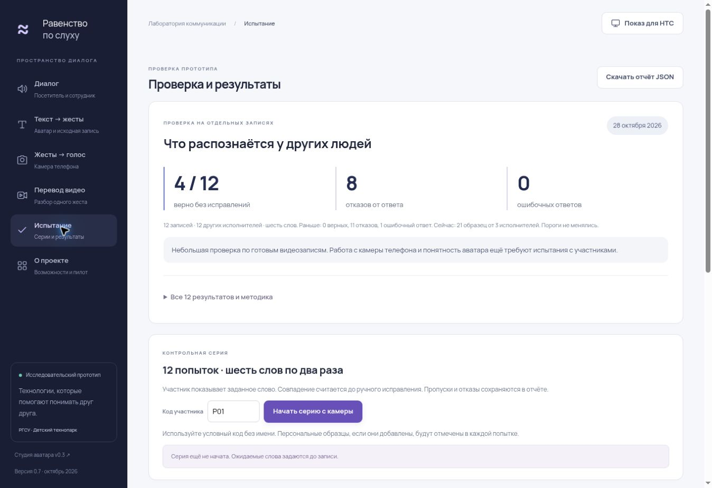

# Версия 0.7 — чище движения, проверяемое распознавание

28 октября 2026.

Заменены записи «Привет!», «Хорошо» и «Друг». У первых двух больше нет пропущенных кистей; у «Друг» два внутренних кадра заполняются при показе по правилам v0.6. Исправлено ложное предупреждение о недоступности видео при быстрой перемотке: завершение старой команды воспроизведения больше не влияет на новую.

Распознавание использует 21 шаблон от трёх исполнителей, шесть слов. На фиксированной группе из 12 записей других исполнителей: четыре верных принятых ответа, восемь отказов, ноль ошибочных принятых ответов. У предыдущих шести шаблонов на той же группе: ноль, одиннадцать, один соответственно. Пороги не менялись. [Методика, все ответы и ограничения](EVALUATION_V07.md).

В «Испытании» появились результаты отдельной проверки и серия из 12 заданий с камеры. Ожидаемое слово задаётся до попытки; ручное исправление не увеличивает число объективных совпадений. Пропуски и незавершённые задания остаются в JSON. Перед записью есть две секунды подготовки, затем три секунды записи. При выходе в обычный диалог скрытое задание не оценивается.

Подготовлены [20 сообщений и задание на запись](PILOT_RECORDING_BRIEF.md), обновлён [сценарий НТС](NTS_DEMO_SCRIPT.md). Полные сообщения остаются текстом до подготовки проверенных записей РЖЯ.

## Проверка реализации

- 52 автоматических теста: воспроизведение, прерывание загрузки/записи, подтверждение до озвучивания, фиксированные задания, отделение ручных исправлений, воспроизводимость сохранённой проверки.
- SHA-256 всех шести видео каталога, связь с motion JSON, число кадров и наблюдаемость координат.
- Все записи каталога отрисованы автоматической проверкой с шагом 1/60 секунды в двух сценах.
- Браузер: контрольная серия, пропуск и завершение, реальный JSON-экспорт, сравнение нового «Хорошо» с исходником и быстрая перемотка без ложной ошибки.
- Интерфейс просмотрен на ширине 390 px. Это проверка компоновки, не испытание физического телефона.
- Повторное скачивание одного выбранного MP4 скриптом диапазонов и сверка SHA-256; повторная сборка компактных признаков из motion JSON дала точное совпадение.

Не выполнены: физический телефон с живым участником, подтверждение слышимости речи, оценка аватара носителями РЖЯ и запись 20 полных сообщений. Автоматическая проверка интерфейса этого не заменяет.

