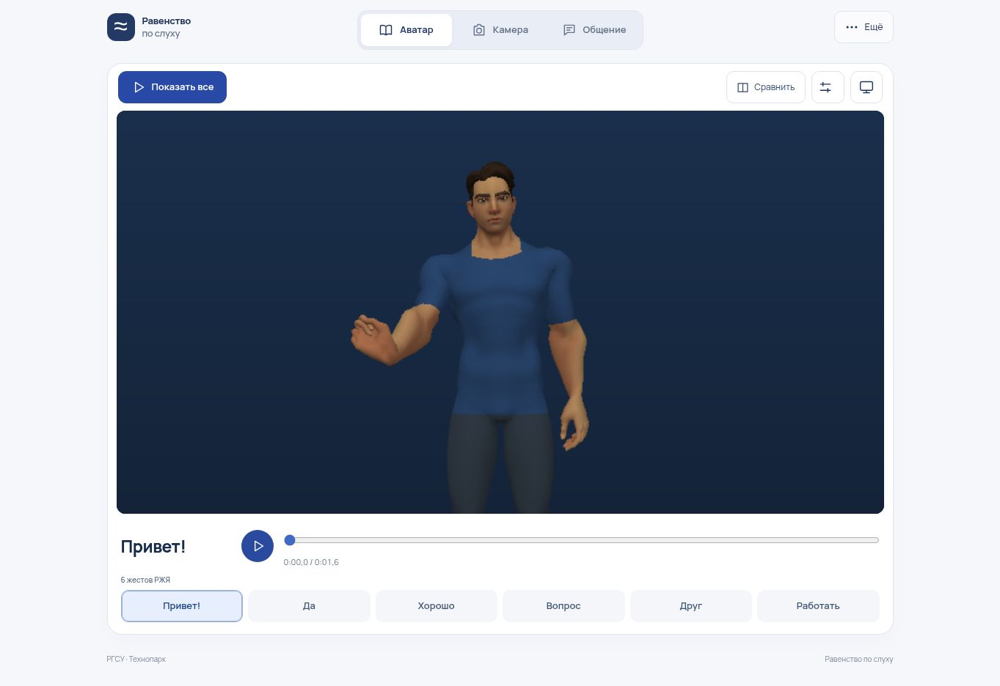

# Аудит и упрощение интерфейса — 0.18

Дата: 30 октября 2026. База: опубликованная версия 0.17.

Проверены структура экранов, основные пользовательские сценарии, загрузка и повтор после ошибки, управление аватаром, доступность элементов, адаптивная компоновка, история сообщений и автономная подготовка. Ниже отделены исправленные проблемы от оставшихся ограничений продукта.

## Что исправлено

| Проблема | Результат |
|---|---|
| Большой заголовок и вводные блоки отодвигали сцену вниз | Компактная шапка, три раздела: «Аватар», «Камера», «Общение». Аватар открывается первым. |
| Автопоказ был спрятан в настройках | «Показать все» запускает шесть слов в крупном режиме одной кнопкой. Без самопроизвольного запуска при открытии. |
| В крупном режиме исчезал выбор слов | Те же шесть кнопок остаются под сценой. Выход обозначен крестиком; Esc и возврат фокуса сохранены. |
| Несколько уровней настроек проигрывателя | Одно окно «Вид и скорость»: скорость, повтор, кадры, сглаживание, поворот, скелет, весь рост. |
| Перегруженный редактор сообщения | Основное действие — «Показать собеседнику». Копирование, отправка, скачивание и голос — в «Передать». |
| Пустые результаты и объяснения занимали экран камеры | До попытки видны камера и запуск. Результат появляется после обработки; подтверждение остаётся обязательным. |
| Простой интерфейс ожидал сетевой загрузки каталога | Навигация и редактор доступны до ответа сети. Добавлены явное состояние и повтор загрузки без потери черновика и без дублирования кнопок. |
| Ошибка движения была скрыта за крупным окном | Сообщение об ошибке находится внутри карточки аватара и остаётся видимым. |
| Открытие меню могло оставлять автопоказ активным | Остановка отменяет также ожидание и переход к следующему слову. |
| Кисти обрезались в портретной сцене | Кадрирование учитывает ширину и глубину шести записанных движений. На узком экране сравнение располагается вертикально. |
| История показывала устаревшую подсказку при уже добавленных репликах | Статус сбрасывается при изменении истории. |
| Справка ссылалась на убранные кнопки | Памятка обновлена под текущие названия и расположение действий. |

Значимые подписи сохранены: название жеста, основные действия, область применения и сообщения об ошибках. Удалены повторяющиеся объяснения; технические подробности доступны по запросу. Иконки имеют доступные названия. Основные кнопки — не менее 44 px; сохранены клавиатура, контраст, крупный текст и настройка уменьшения движения.

## Проверки

- **200/200 автоматических тестов**: `npm test`.
- `npm run verify`: происхождение и хеши всех шести видео, **266 кадров**, девять неподдерживаемых или меняющих смысл входов.
- Новые регрессии: запуск без хеша, интерфейс при медленном каталоге, ошибка и повтор загрузки, отмена последовательности, перемещение контролов в крупный просмотр и обратно.
- Геометрическая проверка всех суставов пальцев во всех кадрах: сглаживание включено/выключено, пять соотношений сторон от 0,35 до 2,5, обычный вид и весь рост. Суставы внутри 95% области проекции. Проверка относится к исходному фронтальному ракурсу; пользовательское приближение может обрезать модель.
- Браузер: полный показ шести слов, сравнение с видео, крупный просмотр, настройки; готовая фраза → крупное сообщение → ответ → история; меню передачи; начальный экран камеры; переключатели доступности.
- Визуальная проверка настольного окна 1363×936 и встроенных тестовых окон шириной 320/390 px, включая крупный режим. Это проверка адаптивной вёрстки, не тест на физическом телефоне.
- Версия ресурсов и автономного комплекта обновлена до 0.18.0. Полнота и ошибки кеширования проверяются автоматическими тестами; реальная работа без сети на целевом устройстве требует отдельного прогона.

## Оставшиеся ограничения

1. Это **шесть подготовленных слов РЖЯ** и свободное текстовое общение. ASL, произвольный перевод предложений и полная языковая мимика не реализованы.
2. Распознаватель и набор данных в этом выпуске не расширялись. Понятность жестов и удобство для пользователей требуют проверки с носителями РЖЯ. Автоматические тесты не заменяют такую проверку.
3. В облачном браузере WebGL недоступен; показ проверен через существующий программный 3D-рендерер. GPU, реальные камера/микрофон и физические мобильные устройства в этот прогон не входят.
4. Системная отправка, голос и разрешения зависят от браузера. Черновик по умолчанию живёт в текущей вкладке; история исчезает при перезагрузке. Пользователь сам выбирает получателя и действие передачи.
5. Это аудит кода и перечисленных сценариев, а не сертификация доступности, независимый тест безопасности или гарантия отсутствия любых ошибок.

## Как показать проект

1. Откройте приложение и нажмите **«Показать все»**.
2. Выберите слово; при необходимости включите **«Сравнить»**.
3. Перейдите в **«Общение»**, напишите фразу и нажмите **«Показать собеседнику»**. В крупном окне собеседник может выбрать **«Ответить»**.

Перед показом без сети: **«Ещё → Показ без интернета → Подготовить показ»**. Дождитесь готовности и проверьте работу на устройстве выступления.
