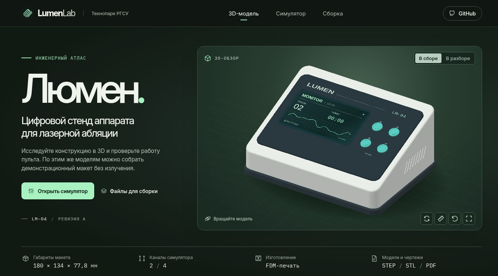

# Люмен LM-04

[Открыть интерактивный 3D-стенд](https://step3dlab.github.io/Technopark_project/lumen-lab/) · [Скачать комплект для мастерской](https://step3dlab.github.io/Technopark_project/lumen-lab/kit/LM-04-kit.zip) · [Руководство по сборке](kit/docs/guide.pdf)

Цифровая демонстрация интерфейса аппарата для лазерной абляции и полностью пассивный макет пульта для оценки эргономики. В настольном макете нет источника излучения, медицинских световодов и управляющей электроники. Показания в браузере условные.

[Готовность к изготовлению аппарата — сверка с 27 пунктами ТЗ](ENGINEERING-STATUS.md)

## На сайте

- Вращение и масштабирование сборки, разнесённый вид, габариты, выбор детали и полноэкранный режим. Доступны WebGL и резервный программный рендеринг той же сетки.
- Пульт на два или четыре условных канала с настройкой индикации, переходами «Ожидание», «Готовность», «Сеанс», «Пауза», «Остановлен» и сбросом. Журнал текущего сеанса можно сохранить в CSV.
- Четыре шага сборки с переходом к нужному узлу в 3D. Исходники, чертежи и файлы на печать доступны с сайта.

## В мастерской

Начните с [руководства](kit/docs/guide.pdf) и сверки с [ведомостью](kit/docs/bom.csv). Габариты пассивной сборки 180 × 134 × 77,8 мм, наклон лицевой панели 20°. Нужны восемь печатных деталей из пяти STL, четыре винта ST2,9 × 16 и монтажная лента толщиной 0,2 мм. Подтверждены замкнутость STL и отсутствие взаимного пересечения 12 CAD-компонентов. Физическая сборка ещё не проверена.

## Структура

| Путь | Содержимое |
| --- | --- |
| index.html, assets/, js/ | Автономный статический сайт со шрифтами, CSS и JavaScript |
| model/assembly.json | Сетка предметного просмотрщика, полученная из тех же CAD-деталей |
| kit/print/ | Пять STL в миллиметрах в ориентации для печати |
| kit/lm04-assembly.step, kit/lm04-assembly.glb | Редактируемая в CAD сборка и цветная модель |
| kit/lm04-model.py, kit/lm04-geometry.json | Параметрический исходник и протокол геометрических проверок |
| kit/docs/ | Руководство, чертёж панели, ведомость, вопросы для дальнейшей разработки |
| tools/guide/, tools/package.py | Генератор документации и сборка архивов |
| assets/*-OFL.txt | Лицензии шрифтов Inter и IBM Plex Mono |

## Локальный просмотр

Запустите в этой папке команду `python -m http.server 8000` и откройте `http://localhost:8000/`. Для работы модели и симулятора доступ в интернет не требуется. Сборщик и внешние CDN сайту не нужны.

Для реконструкции геометрии установите CadQuery 2.7.0 и запустите `python kit/lm04-model.py --output .`. Для повторного формирования PDF и архивов выполните `python tools/guide/build_manual.py` (CadQuery, NumPy, Pillow, ReportLab) и `python tools/package.py`.
