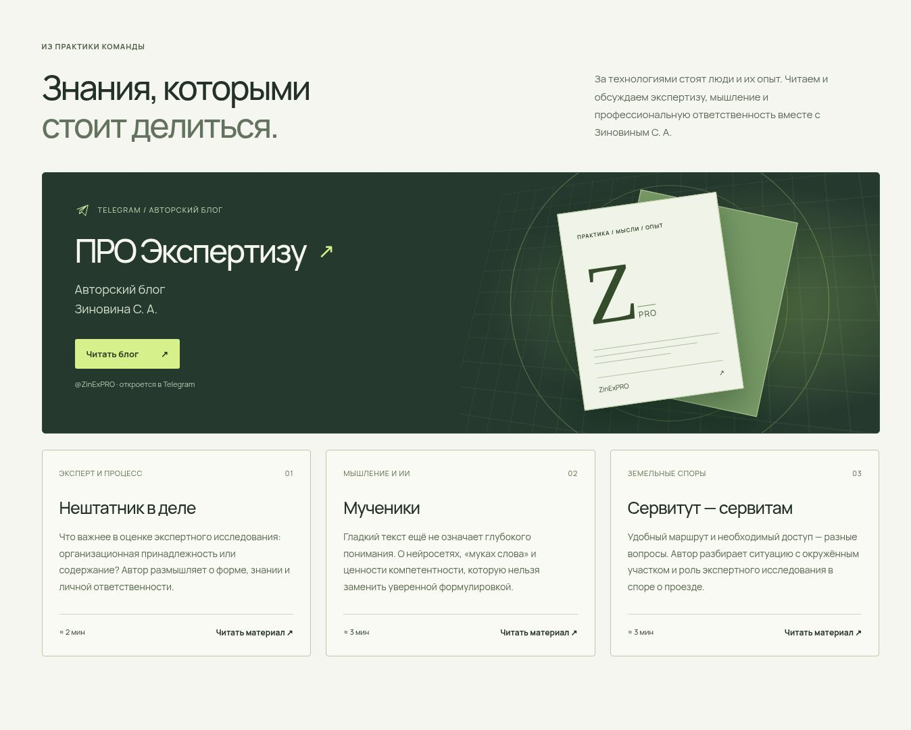

# СЛОЙ LAB — цифровое сканирование, обмеры и материалы для экспертизы

Проект совместного направления МСК-Эксперт и Технопарка РГСУ. Дата концепции: 27.10.2026. **Версия 4.0 — коммерческая структура, содержание и SEO после аналитического брифинга десяти ролей.** Организационная модель лаборатории находится в проработке; исполнитель, возможность выполнения работ и условия согласуются отдельно.

[Коммерческий аудит и два этапа доработки](COMMERCIAL_AUDIT_V4.md) · [Проверки и ограничения QA](QA.md) · [Исторический UX/UI-аудит версии 2.0](UX_UI_AUDIT_V2.md).

## Размещение и статус версии

Проект занимает самостоятельный каталог `sloy-lab/` в репозитории `STEP3DLab/Technopark_project`. Сайт статический: сборка, CDN, ключи и серверная часть для просмотра не нужны. Страницы и локальные ресурсы публикуются с сохранением структуры этого каталога.

Первый этап опубликован коммитом [88a696bd5b64846aada6ce6a1d0703ff843239d9](https://github.com/STEP3DLab/Technopark_project/commit/88a696bd5b64846aada6ce6a1d0703ff843239d9). Версия 4.0 — второй этап этого выпуска. Локальная и браузерная приёмка описаны в QA; состояние размещения показывает [GitHub Actions](https://github.com/STEP3DLab/Technopark_project/actions).

Для постоянного коммерческого размещения требуется отдельное решение: [условия GitHub Pages](https://docs.github.com/en/pages/getting-started-with-github-pages/github-pages-limits) ограничивают использование сервиса как бесплатного хостинга онлайн-бизнеса и сайтов, преимущественно направленных на содействие коммерческим сделкам. Текущий URL не является подтверждением пригодности площадки для такого назначения.

## Страницы

- `index.html`: задачи заказчиков, услуги, результат, форматы работ, факторы стоимости, методы, роли, блог, FAQ, контакты партнёра и конструктор запроса. Сохранены четыре режима архитектурной 3D-сцены.
- `services/index.html`: каталог шести направлений с переходами к составу, условиям и вопросам.
- `services/3d-scanning/index.html`: 3D-сканирование зданий и помещений.
- `services/measurements/index.html`: обмеры, планы, фасады, разрезы и экспликации.
- `services/scan-to-bim/index.html`: информационная модель по облаку точек.
- `services/project-fact/index.html`: сравнение проектной и фактической геометрии.
- `services/expert-support/index.html`: цифровые материалы для строительной экспертизы.
- `services/change-monitoring/index.html`: повторная съёмка и контроль изменений.
- `preparing-project.html`: практический гайд по подготовке объекта, документов и требований к результату. `assets/brief-checklist.txt` — скачиваемый чек-лист и шаблон обращения.
- `data-policy.html`: описание фактической работы формы, локальной подготовки текста и передачи через выбранный посетителем канал. Не подменяет документы отдельного договорного исполнителя.
- `concept.html`: паспорт идеи, альтернативы названия, аудитории, распределение ролей, пилот, этапы запуска, экономика и решения для первой встречи. Есть печатная версия.
- `articles/nonstaff-expert.html`, `articles/thinking-and-ai.html`, `articles/easement.html`: три авторских материала Зиновина С. А., предоставленных владельцем проекта; карточки на главной, связанные переходы и ссылка в канал. Даты не придуманы, автоматическая синхронизация Telegram не подключена.
- `sample-report.html`: структура выдачи для заказчика, строго иллюстративная, без ложных результатов измерений. Есть печатная версия.
- `sitemap.xml`: канонические адреса индексируемых страниц. Партнёрская концепция, описание работы с данными и демонстрационный отчёт имеют `noindex,follow` и исключены из карты.

Посадочные страницы содержат основной текст без JavaScript, отдельные title/description/canonical, хлебные крошки и JSON-LD. Из главной доступны каталог, все услуги и памятка. SVG в `assets/services/` иллюстрируют методы и состав результата, не выдаются за реальные обследования.

## Техническое устройство

- Vanilla HTML/CSS/JS, локальный шрифт Manrope (OFL), локальная Three.js (MIT).
- Three.js WebGL с процедурной архитектурой. Резервный Canvas 2D рендерер использует математическую 3D-проекцию при недоступном WebGL.
- Режимы: облако точек, модель, условные отклонения, управляемый горизонтальный разрез.
- Вращение: перетаскивание / стрелки. Масштаб: +/- или Ctrl+колесо. Сброс: Home / кнопка. Полноэкранный нативный диалог: кнопка / Escape с возвратом фокуса. Видимые кнопки масштаба и справка по управлению.
- Сбой WebGL переводит сцену в Canvas с сохранением выбранного состояния. Учитываются reduced motion, скрытие вкладки и уход сцены за экран; мобильная адаптация. Загрузка 3D начинается при приближении сцены к области просмотра либо явном взаимодействии, с ожиданием свободного времени браузера для пассивного запуска.
- `app.js` управляет главной и формой; `commerce.js` добавляет передачу запроса и выбор услуги из разрешённого URL-параметра. `commerce.css` дополняет исходный дизайн. Самостоятельные страницы услуг не подключают приложение главной.
- Запрос создаётся в памяти вкладки, доступен как карточка, TXT, копируемый текст и печатная версия для сохранения в PDF. Серверной отправки, cookies и постоянного хранения введённого текста нет. Настройки автозаполнения самого браузера находятся вне управления сайта.
- `commerce.js` генерирует DOM-события `sloy:conversion` с разрешёнными идентификаторами действия, места и услуги. Текст формы и произвольные URL-параметры в события не включаются. Аналитический счётчик и сетевая передача событий не подключены; накопленной статистики нет.
- Внешние сетевые зависимости отсутствуют. Внешние ссылки ведут только на первичные источники, исходные тексты по ним не загружаются автоматически.

## Как посетитель передаёт запрос

1. Выбирает тип объекта и город, затем задачу либо описание. Площадь, документы и пожелания к срокам уточняют запрос.
2. Проверяет сформированный текст. Само создание результата не означает отправку или приём заказа.
3. Нажимает «Скопировать запрос», затем «Открыть письмо». Адресат — публичная почта экспертного партнёра `info@sud-mskexpert.ru`.
4. Проверяет письмо, вставляет текст или прикладывает TXT при необходимости и отправляет самостоятельно. Для длинного текста используется короткая почтовая ссылка с явной инструкцией, без скрытого обрезания запроса.

При отказе Clipboard API текст раскрывается и выделяется для ручного копирования; доступны TXT и печать. Прямые `tel:`/`mailto:` и официальный сайт партнёра доступны независимо от формы. Открытие приложения или внешней формы не подтверждает доставку обращения. Контакты не обозначают отдельную утверждённую приёмную СЛОЙ.

## Перед коммерческим запуском

1. Утвердить название и проверить права на него.
2. Подтвердить юридические лица, официальное участие университета, логотипы, ответственных специалистов и их компетенции.
3. Подтвердить реальные модели приборов и доступность ресурсов. Примеры комплектации в партнёрской концепции не являются доказательством оснащённости.
4. Согласовать методики, точность, ПО, применимые требования к измерениям и программу контроля качества.
5. Выполнить пилот, заменить синтетические сцены реальным обезличенным кейсом с правом публикации.
6. Утвердить договоры, состав выдачи, расчёт цены, сроков и ответственность; назначить обработку входящих по опубликованным каналам партнёра.
7. Если появится серверная форма, подготовить законную обработку персональных данных, политику, необходимые согласия и защищённый сервер. Текущая версия данные не отправляет.
8. Выбрать размещение с подходящими коммерческими условиями, подтвердить поисковые кабинеты и определить аналитику. Подготовка sitemap и метаданных не означает фактическую индексацию или рост продаж.

## Ограничения концепции

Модели, размеры в иллюстрациях и цветовые карты синтетические. Кейсы не выдаются за выполненные. На сайте нет выдуманных клиентов, сертификатов, точности, цен или гарантий принятия материалов судом. Инженерные выводы принадлежат специалистам; студенты участвуют под руководством наставников.

## Проверки

Из каталога `sloy-lab/`:

```sh
node --check app.js
node --check commerce.js
node --check scene.js
node --check scene-fallback.js
node --check document.js
node tests/scene-recovery.mjs
node tests/commercial-check.mjs
```

Обе проверки используют стандартные модули Node.js и не требуют npm или сетевого доступа. `scene-recovery.mjs` проверяет четыре сценария восстановления 3D по production-коду. `commercial-check.mjs` проверяет локальные пути и якоря, заголовки, метаданные, canonical, JSON-LD, соответствие FAQ видимому тексту, sitemap и ресурсы CSS/модулей. Эти проверки не измеряют конверсию, поисковые позиции, доступность внешних сайтов или визуальное качество.

Для просмотра нужен статический HTTP-сервер или штатное превью среды, сохраняющее структуру каталога и адресов. В управляемой среде используется `sites-preview start <absolute-checkout>` с настроенной статической директорией. В обычной локальной среде подходит статический HTTP-сервер. Двойной щелчок по `index.html` через `file://` не подходит для ES modules.

После изменения адреса размещения обновите canonical, Open Graph URL, JSON-LD, sitemap и базовый URL проверки `tests/commercial-check.mjs` согласованно. Файл `robots.txt` в подкаталоге проекта не управляет обходом корня домена.

Лицензии зависимостей: `fonts/Manrope-OFL.txt`, `vendor/THREE-LICENSE.txt`.

Официальные источники характеристик и процессуальных разграничений перечислены на странице `concept.html`.

## Превью редакционного блока



